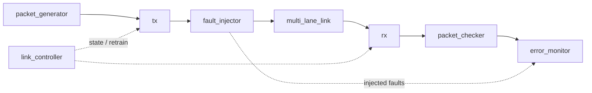

# CHIPLET_MODEL_BASIC


A parameterizable **Verilog model of a chiplet die-to-die interconnect link** with built-in **fault injection** and **error monitoring**. It is the RTL platform for the research project *Chiplet Statistical Testing*, which maps the safe operating region of a link by comparing sampling strategies (random, uniform, and BONR).

## Features

- Multi-lane link (default: 32-bit packets over 2 lanes x 16 bits)
- Packet generator and packet checker for end-to-end data integrity
- Link controller with training modes, link state and retrain request
- Runtime-configurable fault injector: type, rate, burst length, duration, per-lane mask
- Error monitor: total/error packet counters, per-lane error counters, injected-fault counter, overflow flag
- Self-checking testbench (Icarus Verilog) and a thin FPGA top wrapper

## Architecture



> Simplified block view. Update the arrows if the connections in `core.v` differ.

## Repository layout

```text
rtl/    RTL source
tb/     Self-checking testbench
build/  Generated simulation artifacts (not tracked)
```

| File | Role |
|---|---|
| `rtl/top.v` | FPGA physical top (`chiplet_interconnect_top`): exposes only real I/O, fixed demo configuration |
| `rtl/core.v` | `chiplet_interconnect_core`: integrates all blocks; use this directly for Cocotb |
| `rtl/packet_generator.v` | Traffic source (rate set by `traffic_level`) |
| `rtl/tx.v` / `rtl/rx.v` | Transmitter / receiver |
| `rtl/multi_lane_link.v` | Lane model between TX and RX |
| `rtl/fault_injector.v` | Configurable fault injection on selected lanes |
| `rtl/packet_checker.v` | Verifies received packets |
| `rtl/link_controller.v` | Link training / state machine / retrain request |
| `rtl/error_monitor.v` | Packet and error statistics |
| `tb/tb_chiplet.v` | Self-checking testbench |
| `run_tb.ps1` | Compile and run script (Windows + Icarus Verilog) |

## Configuration

Parameters of `chiplet_interconnect_core`:

| Parameter | Default | Meaning |
|---|---|---|
| `WIDTH` | 32 | Packet width (bits) |
| `NUM_LANES` | 2 | Number of lanes |
| `LANE_WIDTH` | 16 | Bits per lane |

Main control inputs:

| Signal | Width | Meaning |
|---|---|---|
| `link_enable` | 1 | Enable the link |
| `training_mode` | 2 | Link training mode |
| `traffic_level` | 8 | Traffic intensity |
| `fault_enable` | 1 | Enable fault injection |
| `fault_type` | 2 | Fault type |
| `fault_rate` | 8 | Fault probability/rate |
| `burst_length` | 8 | Length of a fault burst |
| `fault_duration` | 8 | Duration of an injected fault |
| `fault_lane_mask` | 2 | Lanes affected by faults |

Status outputs include `link_up`, `link_state`, `lane_enable`, `retrain_req`, `fault_active`, `fault_inject_count`, `total_packets`, `error_packets`, `lane_error_cnt0..3`, `injected_faults`, `error_overflow`.

## Quick start

### Requirements

- [Icarus Verilog](https://bleyer.org/icarus/) (`iverilog`, `vvp`) with `-g2012`

### Run the testbench (Windows)

1. Open `run_tb.ps1` and set `$iverilog` / `$vvp` to your install path.
2. Run:

```powershell
powershell -ExecutionPolicy Bypass -File .\run_tb.ps1
```

### Run manually (any OS)

```bash
mkdir -p build
iverilog -g2012 -Wno-timescale -o build/tb_chiplet.vvp \
  tb/tb_chiplet.v rtl/core.v rtl/packet_generator.v rtl/tx.v rtl/fault_injector.v \
  rtl/multi_lane_link.v rtl/rx.v rtl/packet_checker.v rtl/link_controller.v rtl/error_monitor.v
vvp build/tb_chiplet.vvp
```

## Notes

- `top.v` is the FPGA wrapper; for Cocotb, instantiate `chiplet_interconnect_core`.
- Fault injection is measured as packet/lane errors.
- Retraining is deliberately disabled so a corrupted packet does not truncate a characterization run.

## Research context: Chiplet Statistical Testing

Goal: map the safe operating region of the link as a function of fault parameters (e.g. `fault_rate`, `burst_length`, `fault_duration`), where the safe region is separated from the unsafe one by the boundary `p_fail = θ`.

Three sampling strategies are compared:

1. **Random** sampling
2. **Uniform** (grid) sampling
3. **BONR** (Boundary-Oriented Neighborhood Refinement): concentrates samples and refines neighboring points around the `p_fail = θ` boundary

Results: _to be added (figures, number of samples vs boundary error)._

## Roadmap

- [ ] Cocotb testbench for `chiplet_interconnect_core`
- [ ] Python scripts for random / uniform / BONR sampling and plotting
- [ ] Result figures and comparison table
- [ ] FPGA implementation report (Libero SoC)

## Author

**Vo Quoc Tuan** - Integrated Circuit Design, Danang University of Science and Technology
GitHub: [@qtundeptraidut](https://github.com/qtundeptraidut)

## License
