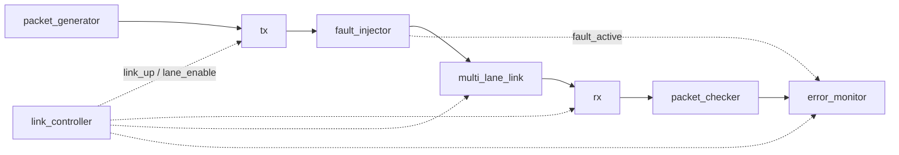

# CHIPLET_MODEL_BASIC

Verilog model of a chiplet die-to-die interconnect link, built for my research on *Chiplet Statistical Testing* at Danang University of Science and Technology. The link generates traffic, injects configurable faults on selected lanes and measures packet/lane error rates, with a self-checking testbench in Icarus Verilog.

The goal is to compare three sampling strategies — random, uniform (grid) and **BONR** (Boundary-Oriented Neighborhood Refinement: concentrates samples and refines neighbors around the `p_fail = θ` boundary instead of spreading them evenly over the parameter space) — to map the safe operating region of the link as a function of fault parameters such as `fault_rate`, `burst_length` and `fault_duration`.

## Status

- Multi-lane link, packet generator/checker, link controller, fault injector and error monitor are implemented and pass the self-checking testbench.
- Retraining is deliberately disabled: one corrupted packet must not truncate a characterization run, so faults are measured as packet/lane errors.
- Cocotb testbench and the BONR sampling scripts are not done yet.

## Architecture



Arrows follow the instantiations in `rtl/core.v`: `packet_generator -> tx -> fault_injector -> multi_lane_link -> rx` is the data path; `packet_checker` taps `rx_data`/`rx_valid`; `link_controller` drives `link_up`/`lane_enable` into tx/rx/multi_lane_link and `error_monitor`; `fault_injector` reports `fault_active` into `error_monitor`. `retrain_req` is an output only — nothing inside the core consumes it.

## Repository layout

```text
rtl/    RTL source
tb/     Self-checking testbench
build/  Generated simulation artifacts (not tracked)
```

Only the non-obvious files:

| File | Why it exists |
|---|---|
| `rtl/core.v` | `chiplet_interconnect_core` — integrates all blocks; use this for Cocotb |
| `rtl/top.v` | FPGA physical top (`chiplet_interconnect_top`); real I/O only, fixed demo configuration |
| `rtl/link_controller.v` | Link training / state machine; `link_up` and `lane_enable` are its outputs |

## Configuration

Parameters of `chiplet_interconnect_core`:

| Parameter | Default | Meaning |
|---|---|---|
| `WIDTH` | 32 | Packet width (bits) |
| `NUM_LANES` | 2 | Number of lanes |
| `LANE_WIDTH` | 16 | Bits per lane |

See the header of `rtl/core.v` for the full port list and control/status signals (`link_enable`, `fault_rate`, `burst_length`, `fault_lane_mask`, `link_up`, `total_packets`, `error_packets`, ...).

## Quick start

Requires [Icarus Verilog](https://bleyer.org/icarus/) with `-g2012`.

Windows:

1. Open `run_tb.ps1` and set `$iverilog` / `$vvp` to your install path.
2. Run `powershell -ExecutionPolicy Bypass -File .\run_tb.ps1`

Any OS:

```bash
mkdir -p build
iverilog -g2012 -Wno-timescale -o build/tb_chiplet.vvp \
  tb/tb_chiplet.v rtl/core.v rtl/packet_generator.v rtl/tx.v rtl/fault_injector.v \
  rtl/multi_lane_link.v rtl/rx.v rtl/packet_checker.v rtl/link_controller.v rtl/error_monitor.v
vvp build/tb_chiplet.vvp
```

## Author

**Vo Quoc Tuan** — Integrated Circuit Design, Danang University of Science and Technology

GitHub: [tuanvo-ic](https://github.com/tuanvo-ic)
